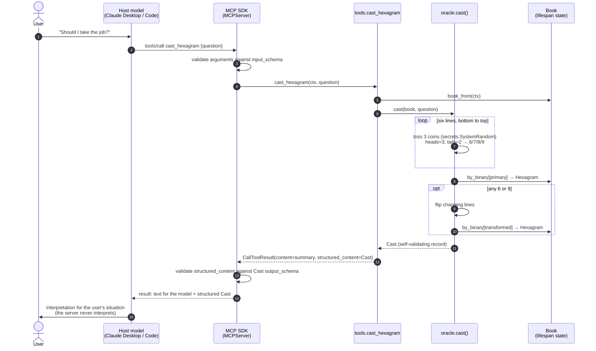

# Architecture

Two layers, one rule: **the domain layer does not know MCP exists.**

```
┌──────────────────────────── protocol layer (imports mcp) ────────────────────────────┐
│ cli.py        parse args, configure logging, server.run(transport, ...)              │
│ server.py     create_server(): identity + lifespan; calls each module's register()   │
│ state.py      AppState (the loaded Book) and book_from(ctx)                          │
│ tools.py      cast_hexagram, get_hexagram, get_trigram, describe_method              │
│ resources.py  iching:// resources, templates, the completion handler                 │
│ prompts.py    consult, consult_decision, study_hexagram                              │
└──────────────────────────────────────────┬───────────────────────────────────────────┘
                                           │ plain function calls
┌──────────────────────────── domain layer (no mcp imports) ───────────────────────────┐
│ oracle.py     cast(), lookups, describe_method(): pure functions                     │
│ book.py       load_book(): JSON → validated, immutable Book                          │
│ models.py     Trigram, Hexagram, LineValue, CoinToss, Cast, flip(), Book, …          │
│ render.py     plain text / Markdown renderings of domain objects                     │
│ data/         trigrams.json, hexagrams.json, SOURCES.md                              │
└──────────────────────────────────────────────────────────────────────────────────────┘
```

| Module | Why it exists |
|---|---|
| `cli.py` | The only code that touches the process: arguments, logging to stderr, choice of transport. |
| `server.py` | Says *what the server is* (name, title, version, instructions, lifespan) and nothing about how it is served. |
| `state.py` | The one object the lifespan yields, and the one way a handler reaches it. Separate from `server.py` so primitive modules can import it without a cycle. |
| `tools.py` | Model-controlled actions. Thin: get the book, call the oracle, map `NotInBook` to `ToolError`. |
| `resources.py` | Application-controlled data. Maps `NotInBook` to `ResourceNotFoundError`. Holds the server's single completion handler. |
| `prompts.py` | User-controlled intents. They ask the host to cast and interpret; they never interpret. |
| `oracle.py` | The rules of the three-coin method. Takes an injectable RNG, so tests are deterministic. |
| `book.py` | Loads and checks the data once. Bad data stops the server at startup. |
| `models.py` | The vocabulary. The same models validate the data and become the tools' `output_schema`. |
| `render.py` | Text for humans and models, kept out of both the oracle (no prose) and the handlers (no formatting noise). |

`tests/test_layers.py` enforces the rule: it fails if `oracle`, `book`, `models` or `render`
imports anything from `mcp` or from the protocol-layer modules.

## Lifecycle

1. `cli.main()` configures logging (stderr), calls `create_server()`, then `server.run(...)`.
2. `create_server()` builds the `MCPServer` (identity only) and calls `tools.register`,
   `resources.register` and `prompts.register`, which apply the decorators. Nothing else
   runs at import time.
3. When the transport starts, the SDK enters `app_lifespan` **once**: `load_book()` validates
   both JSON files, `resources.publish_static()` registers the two fixed resources, and the
   lifespan yields `AppState(book=...)`.
4. Every request gets a fresh `Context`. Handlers call `book_from(ctx)` to reach the
   shared, immutable book.

## One `cast_hexagram` call, end to end



## Errors: one domain error, three protocol shapes

`oracle` raises `NotInBook` for anything the book does not contain. Each primitive maps it
to the channel its caller can use:

| Where | Becomes | Who sees it |
|---|---|---|
| a tool | `ToolError` → result with `is_error=True` | the **model**, which can retry |
| a resource | `ResourceNotFoundError` → JSON-RPC `-32602`, URI in `data` | the **host application** |
| a prompt | `MCPError(INVALID_PARAMS)` → JSON-RPC `-32602` | the **host UI** (the user typed it) |

Anything else that goes wrong is a bug. It propagates, the SDK returns an opaque error
("Error executing tool …"), and the traceback goes to the server log on stderr.

## Transports, and why any replica can serve any request

The same `create_server()` runs over both transports. `cli.py` chooses which:

- **stdio** (default): the host launches the process and speaks over stdin/stdout. Nothing
  else may write to stdout; all logging goes to stderr.
- **Streamable HTTP**: `server.run("streamable-http", host=, port=, stateless_http=True)`.
  The endpoint is `http://<host>:<port>/mcp`.

Under protocol **2026-07-28** MCP is stateless. There is no `initialize` handshake and no
`Mcp-Session-Id`: each request carries its protocol version and client capabilities in
`_meta`. This server keeps no per-client state either. The book is immutable and loaded
identically by every process, and a cast depends only on fresh coins. So **any replica can
answer any request**: put several processes behind a round-robin load balancer with no sticky
sessions. `stateless_http=True` extends the same behaviour to legacy (2025-era) clients, which
would otherwise get sessions.

Verified by hand while building, with the Inspector commands in the README: the Inspector
lists and calls everything over both transports, and a raw 2026-07-28 `POST /mcp` with no
handshake returns `200` with no `Mcp-Session-Id` header. `tests/test_cli.py` launches the real
process over stdio on every test run.
